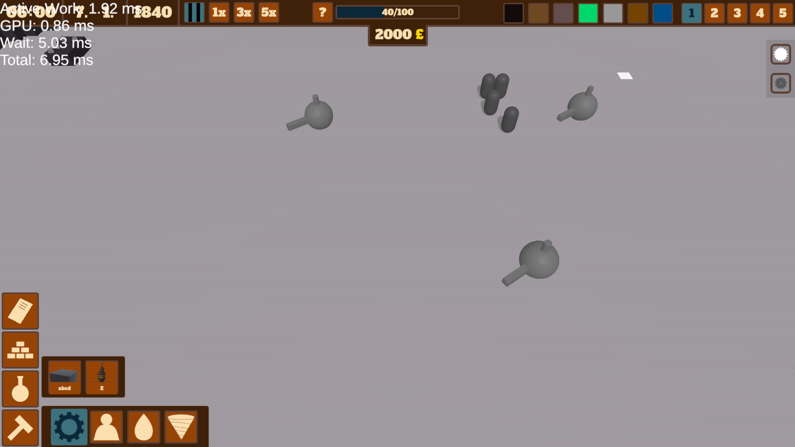
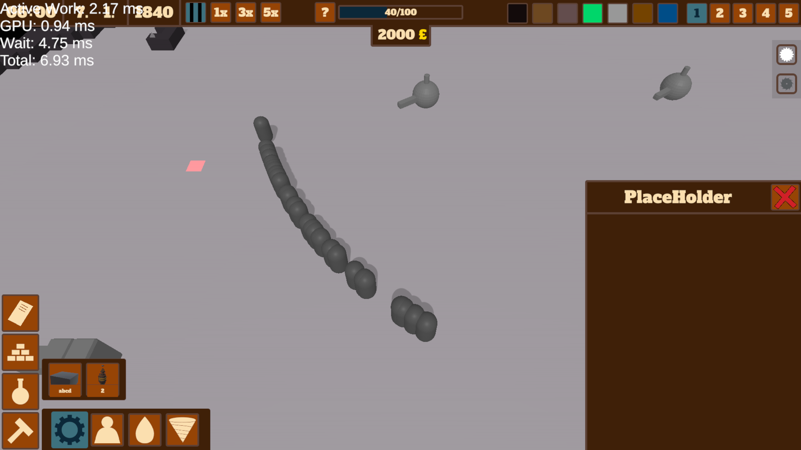

# About this game
This is a game about building a secret underground mining colony, whichs primary goal is extracting a new unknown mineral called "Steamite", because of it's incredible energy yield.
The game is set in the end of the first industrial era and continues into the basics of electrification (WIP). 

### How to play 
Download and play from [itch.io](https://isakobe.itch.io/steamite)

### Bug report
When you find a bug, or want to say something about this game, please tell me about it(discord - isakobe).

#### Credits
- Programing and Game Design - Richard Kopp
- Models - Vojta Liebich

### Performance rework
I wanted to make the game bigger so I'm currently working on a transition to an aproach that requires a lot less gameobjects.
#### Path to restoration
- [x] Grid
- [ ]  Humans
- [ ]  Buildings
- [ ]  Pipes
- [ ]  Saves

### Terra
- Visit the ? button in game for help and testing changes
- Use keyboard keys to change selection modes
- default - selection, also sets destination for humans
- g - dig mark (WIP)
- h - tile toggle
- DELETE - deconstruction